<p align="center">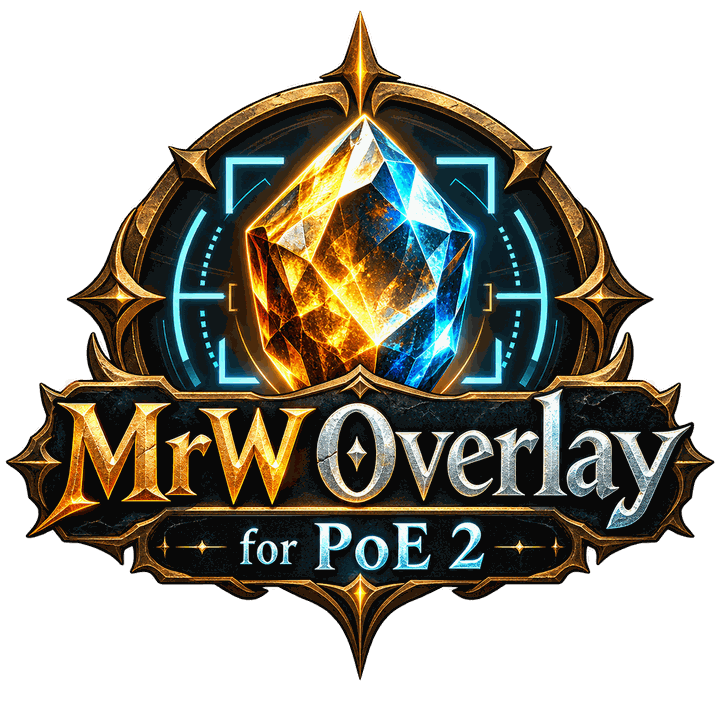</p>

<p align="center"><b>Günün fiyatlarını bilen bir loot filtresi ve normalde tek tek arayıp bulacağın bütün araçlar, tek uygulamada.</b><br>
Fiyat sorgulama, trade, canlı arama, craft simülatörü, Expedition fiyatları, map kazancı takibi. Sen farmlarken tepside sessizce çalışır.</p>

<p align="center">
  <a href="https://apps.microsoft.com/detail/9PM376D3LFBG"></a>
  <a href="https://buymeacoffee.com/mrworth"></a>
</p>
<p align="center">
  <a href="../../releases/latest"></a>
  <a href="https://chromewebstore.google.com/detail/ibjjhhjnfdokcbfckecbpkpibpdclpmn"></a>
  <a href="https://microsoftedge.microsoft.com/addons/detail/djfodaadmhknalfdphcadiojbfabedlc"></a>
  <a href="https://addons.mozilla.org/firefox/addon/mrw-overlay-for-poe-2-bridge/"></a>
  <a href="https://discord.gg/835k5r4k8k"></a>
  
  
</p>

<p align="center"><a href="README.md">English</a> · <a href="https://poe2.mrwproject.com/tr/">Web sitesi</a></p>

<p align="center">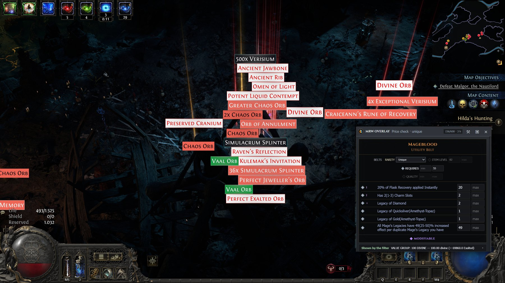</p>

## Neden MrW Overlay?

- **Yedi araç yerine tek uygulama.** Loot filtresi, fiyat sorgulama, trade ve canlı arama, craft simülatörü, Expedition fiyatları, satış ve map kazancı takibi, oyun kısayolları. Bir sürü araç ve site arasında alt-tab yapmaya son.
- **Filtren piyasayla birlikte güncellenir.** Bir değer belirlersin, diyelim 50 ex. Üstündeki drop'lar parlar, ucuzlar gizlenir ya da soluklaşır. Fiyatlar değiştikçe filtre de değişir; lig ortasında listeleri elle düzeltmezsin.
- **Oyunun hangi dildeyse o dilde.** English, Deutsch, Français, Español, Português, Русский, 日本語, 한국어 ya da 繁體中文: fiyat sorgusu, trade ve Expedition fiyatları eşyayı oyunun yazdığı gibi okur, o dilde gösterir, ilanları da o dilde getirir. Oyunun sunduğu dillerin hepsi çalışıyor; yalnız Tayca desteklenmiyor.
- **Çıktığı her platformda onaylı.** Microsoft Store, Chrome Web Store, Edge Add-ons ve Firefox Add-ons inceleyip onayladı.
- **Ücretsiz.** Ücretli sürüm ya da "premium" özellik yok, herkes aynı uygulamayı kullanır.

## Özellikler

### Canlı fiyatlı loot filtresi
[NeverSink'in filtresinin](https://github.com/NeverSinkDev/NeverSink-Filter-for-PoE2) üstüne kurulur: NeverSink'in bütün emeği yerinde kalır, senin fiyat kuralların en üste eklenir. Unique fiyatları poe.ninja'dan, currency ve yığınlanan eşyalar oyun içi Currency Exchange'te gerçekleşen takaslardan (orada az takas görenleri poe2scout ve poe.ninja tamamlar), exceptional tabanlar (fazla soketli ya da %21+ kaliteli) resmi trade sitesinden gelir. Bu fiyatları MrW Overlay'in kendi sunucuları hesaplar ve tabanları günün her saati tarar; fiyatlar sana hazır gelir. Filtre varsayılan olarak 4 saatte bir kendini günceller.

<p align="center">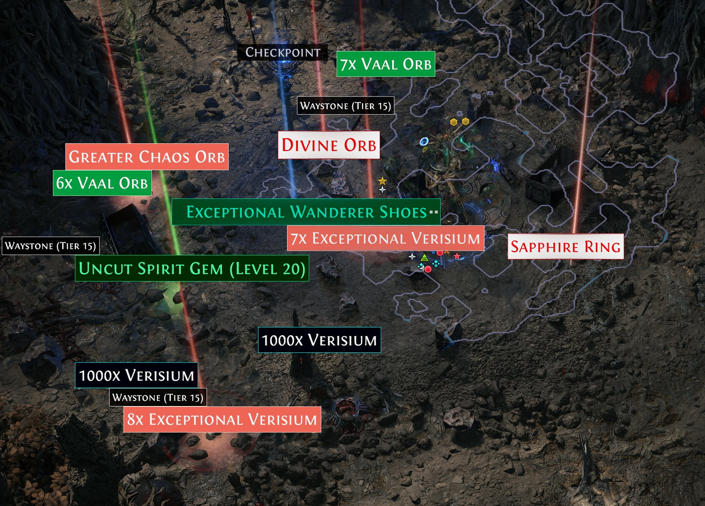</p>

### Kendi grupların, renklerin, seslerin
12 gruba kadar kendi kurallarını yaparsın: her zaman göster ya da gizle listeleri, ya da ex, chaos veya div cinsinden kendi eşiği olan değer katmanları. Her grubun kendi rengi, ışık hüzmesi, minimap ikonu ve sesi olur. Uygulamanın hazır stillerinden, NeverSink'in 68 stilinden seçebilir ya da kendin yapabilirsin. Oyunun 26 uyarı sesinin hepsini seçmeden önce dinleyebilirsin.

<p align="center">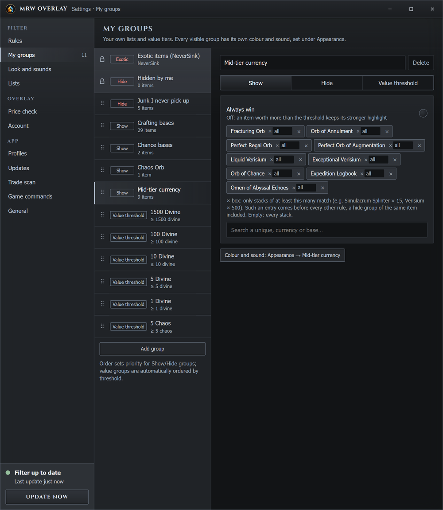 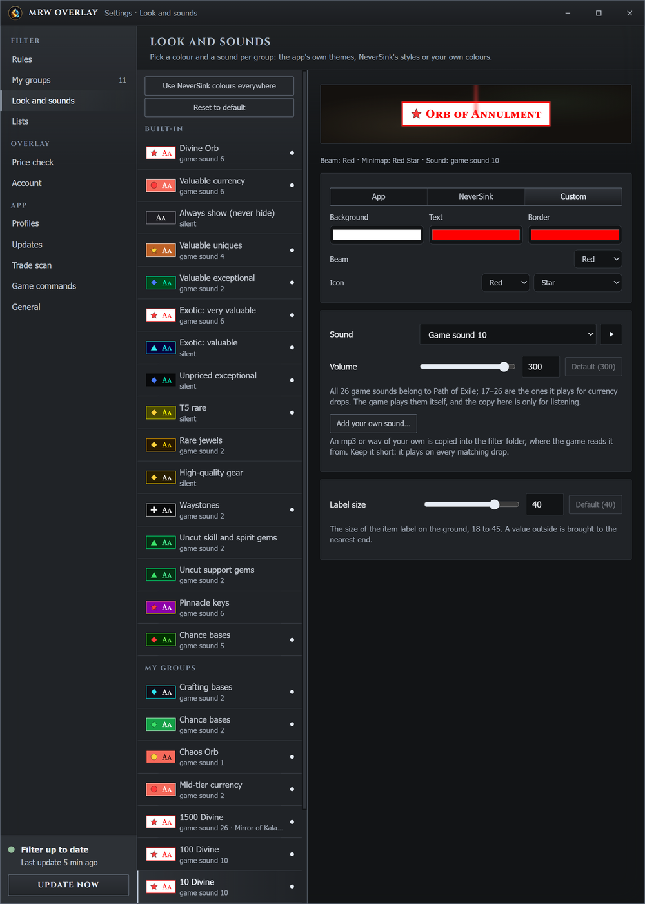</p>

### Map kazancı, Alt+I
Her map'in gerçekte ne getirdiğini gör. Uygulama envanterindeki currency'yi map'ten önce ve sonra ekrandan okur; envanterin artışı, loot filtresinin fiyatlarıyla, o map'in kazancıdır. Takip penceresindeki Map kazancı sekmesi bunu oyunun logundaki sürelerle birlikte toplar: oturum süresi, map'te ve hideout'ta geçen süre, map başına ve saatte kazanç, ortalama ve son map süresi, en iyi map ve en çok gelenler. Oyunun üstündeki küçük kutu, map'te de, seçtiğin değerleri gösterir; **Yeni oturum başlat** ile hiçbir şeyi silmeden bir farmı diğeriyle karşılaştırabilirsin. GGG izin verirse kazanılan experience de bu değerlere eklenecek.

Nasıl okuyacağını **Ayarlar → Price check → Envanter taraması**'ndan seçersin. Sen seçene kadar **Kapalı** kalır:

- **Otomatik:** hideout ya da kasabada envanter her açık olduğunda uygulama onu saniyede bir kadar okur. Map'te hiçbir şey okunmaz. Atlas'tan map'e girerken envanter zaten açılır (waystone cihaza oradan gider), bu yüzden çıkmadan önceki son okuma map'in başlangıcı olur; kutu saatiyle birlikte **Taban alındı** yazar. Dönünce stash'e bir şey koymadan önce envanteri aç: açık kaldığı ilk saniyeler map'in ne getirdiğini söyler, okurken kutu geri sayar. Sonrasında stash'e atmak hiçbir şeyi değiştirmez.
- **Manuel:** hiçbir şey kendiliğinden okunmaz. Map'ten önce hideout'ta envanter açıkken **Alt+I**'ye bas, dönünce de stash'e bir şey koymadan önce yine bas. Alt+I iki kuralda da envanterinin o anki değerini gösterir.

<p align="center">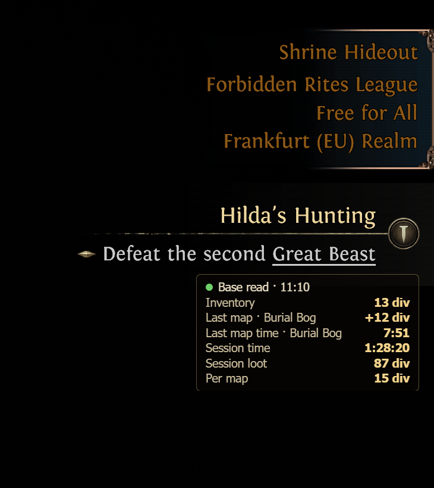 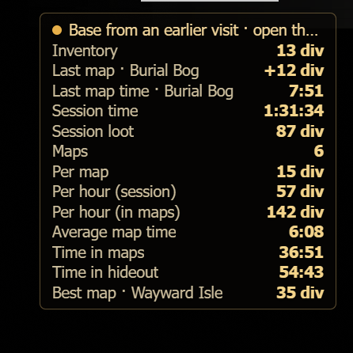</p>

> **Neler sayılır:** yalnız Ange'nin Currency Exchange'inde takas edilen eşyalar: currency, omen, essence, splinter, fragment, catalyst, uncut gem, flux ve benzerleri. Unique, rare, ekipman, waystone ve değeri affix'lerine bağlı her şey sayılmaz; ekrandan ne oldukları anlaşılmaz.
>
> **Bilmekte fayda var:**
> - Map'ten sonraki okumadan önce stash'e konan sayılmaz. Otomatik'te dönüşün ilk saniyelerinde alınan ya da takas edilen şeyler kazanca girer.
> - Bir hücre kesin okunamazsa (eksik bir rakam, bir gem seviyesi) kart ve Takip onu "2. satır, 7. sütun" gibi adıyla gösterir; o map'in değeri yanlış olabilir.
> - Hideout süresine AFK süresi ve tek kalışta 10 dakikayı aşan kısım girmez; mola, saatlik kazancını bozmaz.
> - Tooltip okumayı engellemesin diye Alt+I fare imlecini bir anlığına eşyaların üstünden çeker ve geri koyar. Asla tıklamaz.

<p align="center">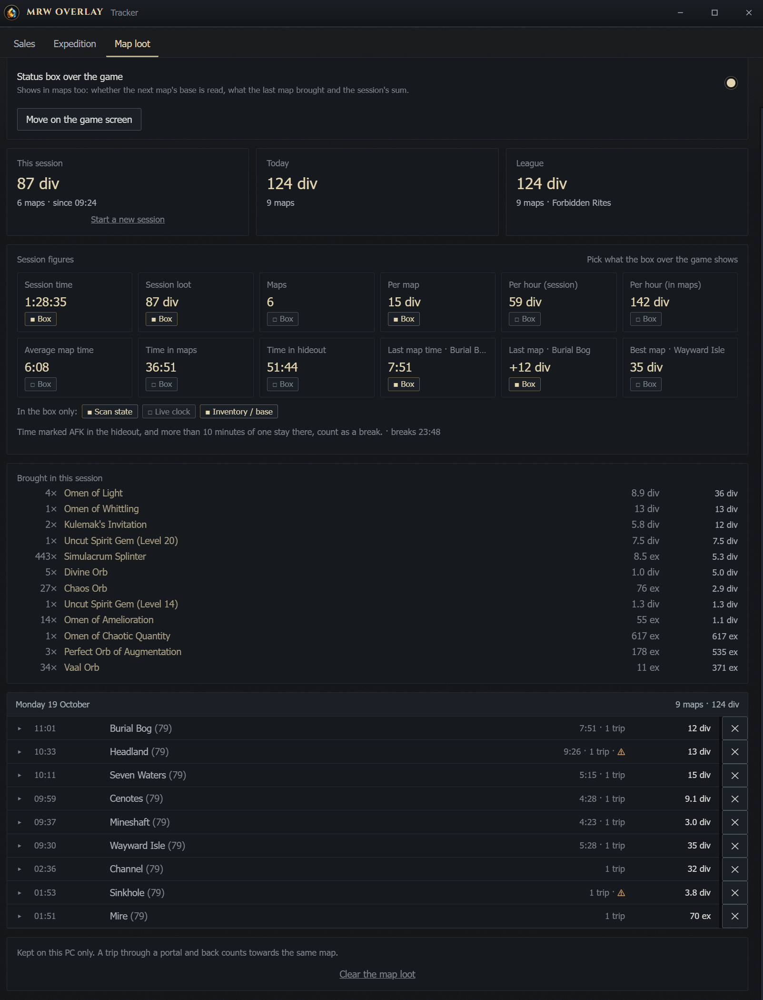 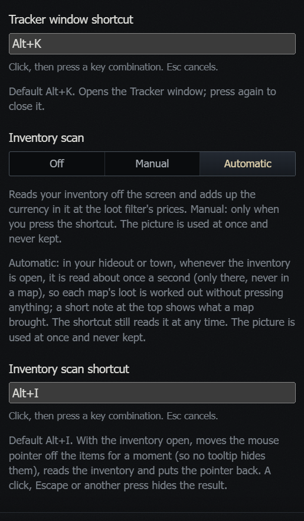</p>

### Fiyat sorgulama, Alt+E
Oyunda eşyanın üstüne gel ve Alt+E'ye bas. Küçük bir pencere eşyayı okur. Affix'leri, DPS'i ve özellikleri aramaya ekleyip çıkarabilirsin; arama resmi trade sitesinde yapılır. Skills panelindeki gem'leri ve Expedition ödüllerini doğrudan ekrandan da okuyabilir.

<p align="center">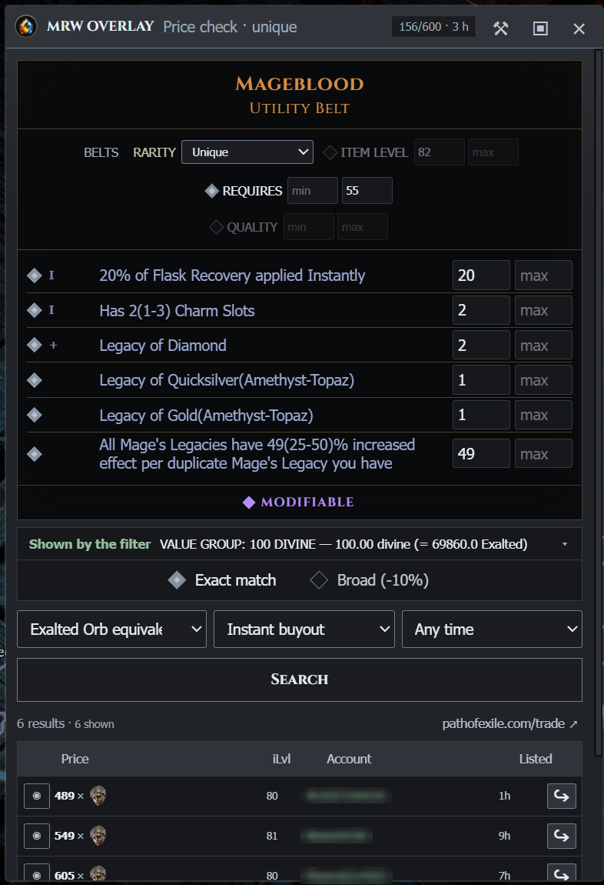 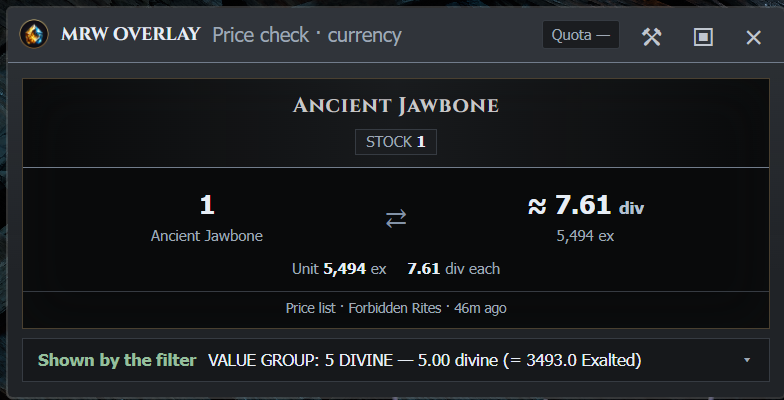</p>

**Filtren bu eşyaya ne yapıyor?** Aynı pencere, loot filtrenin eşyayı gösterip göstermediğini ve bunu hangi kuralın belirlediğini söyler. Bir daha görmek istemiyor musun? **Alt+H** onu filtreden gizler: ya tamamen ya da yalnız ucuzken. Gizlediğin her şey "Gizlediklerim"e düşer, oradan geri alabilirsin.

<p align="center">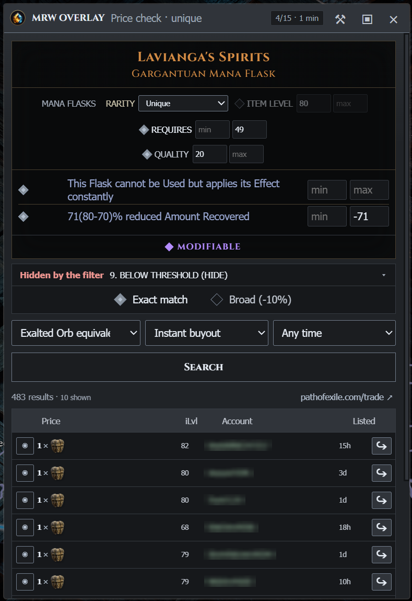 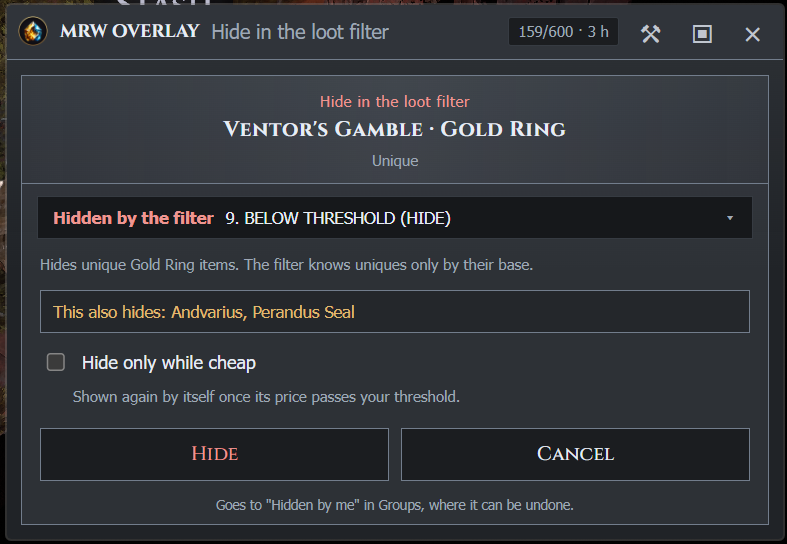</p>

### Trade ve canlı arama, Alt+M
Oyunun üstünde açılan tam bir trade araması. Her arama ayrı bir sekmede açılır, kayıtlı aramalar klasörlerde durur. Tek tıkla "bu eşyanın modlarıyla ara" yapabilirsin; anında satın alınabilen ilanlarda tek tuşla satıcının hideout'una gidersin. Canlı aramalar sen oynarken sesle ve bildirimle haber verir.

<p align="center">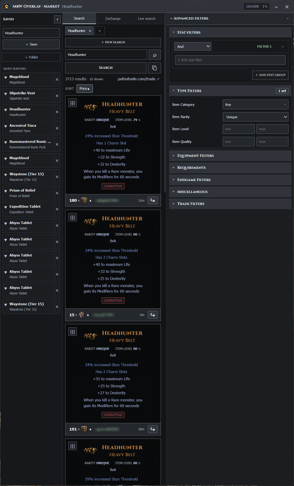 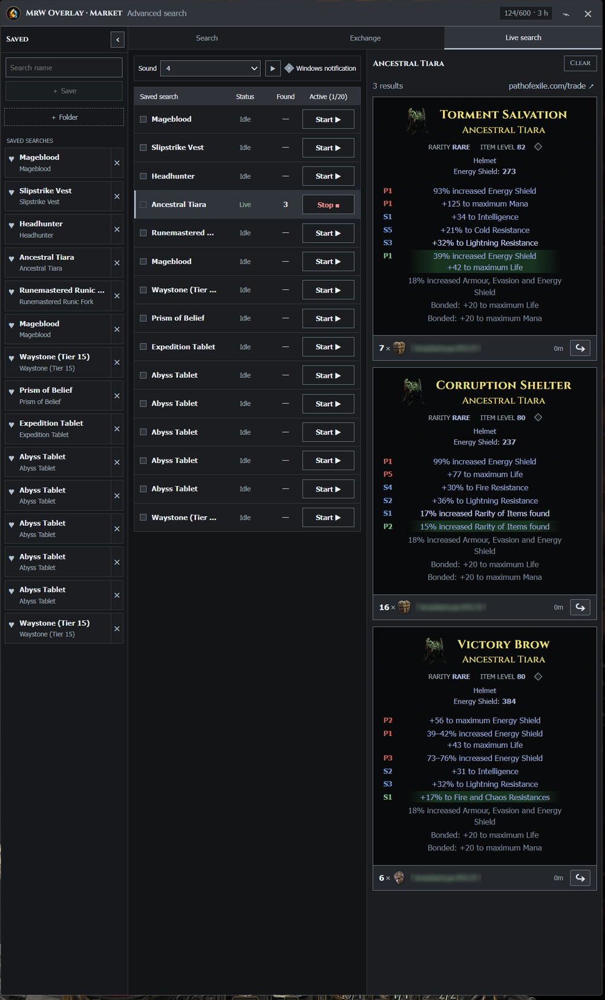</p>

### Teorik Craft, Alt+F
Oyunun kendi craft sistemi gibi çalışsın diye yapılmış bir craft simülatörü. Gerçek tabanlar, gerçek mod ağırlıkları ve tier'lar; orb'lar, omen'ler, essence'lar, Desecrate, Fracturing, catalyst'ler, Vaal ve Sanctify, jewel'lar, alloy'lar ve liquid'ler. Orb'u al, eşyaya tıkla, aynı oyundaki gibi. Tıklamadan önce her modun gelme ihtimalini görürsün. Craft'ın sana bugünkü fiyatlarla kaça patladığını hesaplar ve çıkan eşyanın fiyatına bakar. Oyunda kopyaladığın eşyayı craft penceresine gönderip sonraki adımını planlayabilirsin.

<p align="center">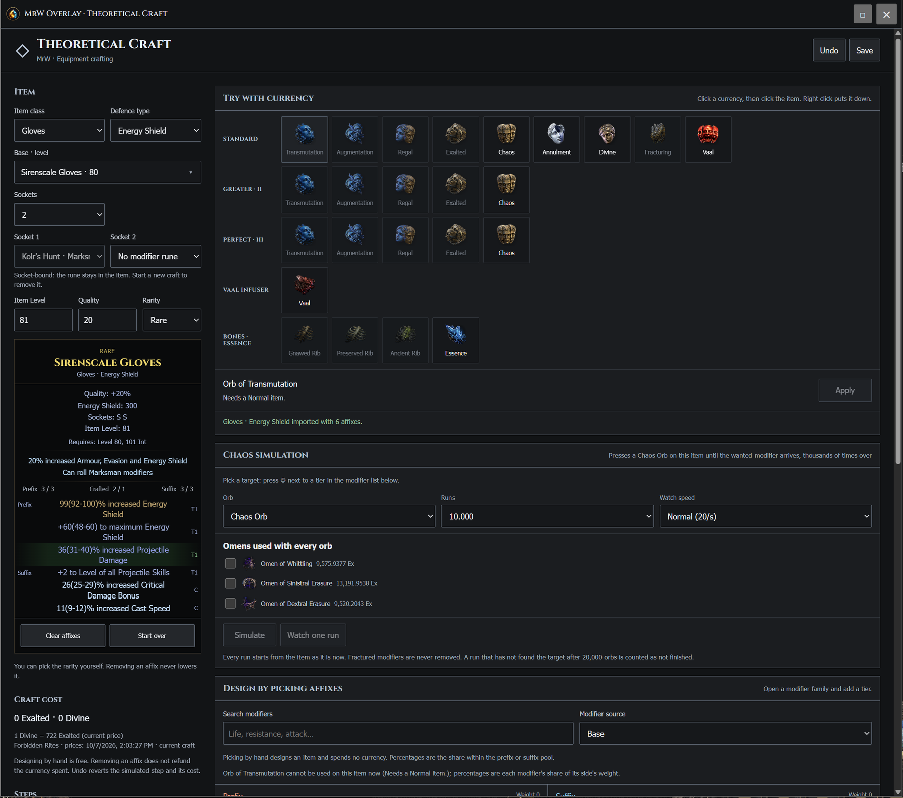</p>

### Expedition fiyatları, Alt+Q
Runeshape Combinations panelini aç ve Alt+Q'ya bas. Her ödülün yanına, değer gruplarının renginde bir fiyat etiketi gelir. Bir tuşa basmak tek bir okuma demektir; Alt+Q ekranını sürekli izlemez.

<p align="center">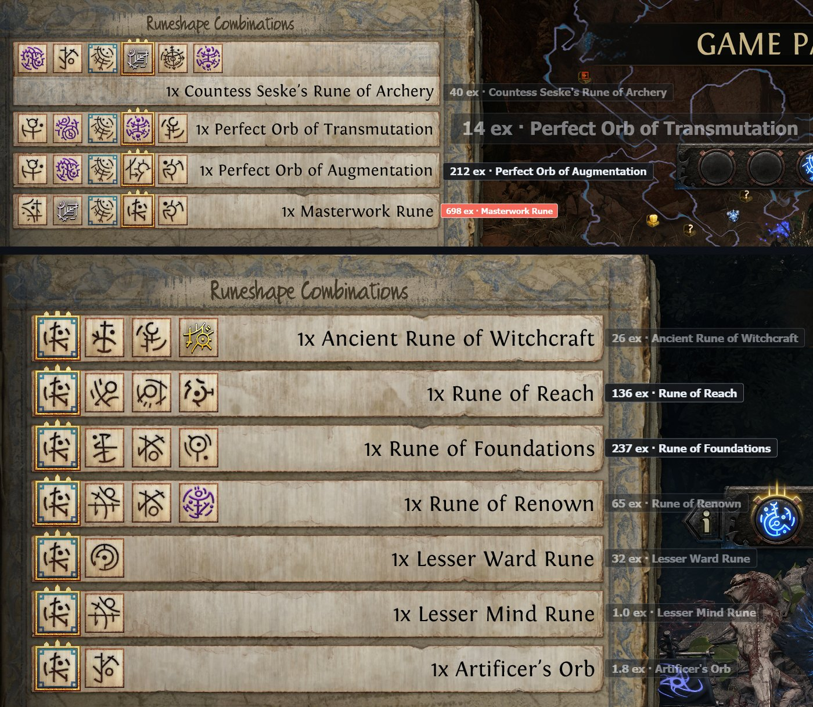</p>

**Seçimlerin toplanır.** Alt+Q'dan sonra aldığın ödüle tıkla: uygulama onu seçildiği map'le birlikte saklar. Oyunun üstündeki küçük bir kutu bu map'in ve bu oturumun seçimlerini toplar (istersen adlarını da listeler), Takip penceresindeki Expedition sekmesi de her map'i seçimleriyle birlikte, oturum, gün ve lig toplamlarıyla gösterir.

> **Not:** Uygulama düşen eşyaları göremez ve senin yerine seçim yapmaz. Yalnız Alt+Q ile taradıktan sonra tıkladığın seçimleri takip eder.

<p align="center">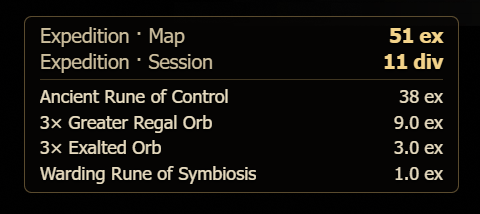 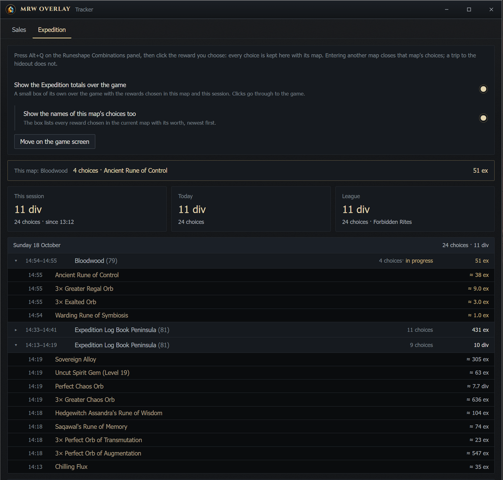</p>

### Satış takibi, Alt+K
Satıcının (Ange) yaptığı satışlar gün gün: bu oyun oturumu, bugün ve lig toplamları bugünkü kurla, sattığın her şeyde arama. Uygulama kendi satış geçmişini tarayıcı bağlantısıyla pathofexile.com'dan, oyunda Ange konuştuktan kısa süre sonra okur ve bilgisayarında saklar; böylece geçmiş, trade sitesinin gösterdiği son 100 satışın ötesine uzar. İsteğe bağlı küçük bir şerit oyunun üstünde bu oturumun ve ligin kazancını gösterir: tıklamalar oyuna geçer, şeridi ekranda istediğin yere sürükleyebilirsin. İkisi de sen açana kadar kapalıdır.

<p align="center">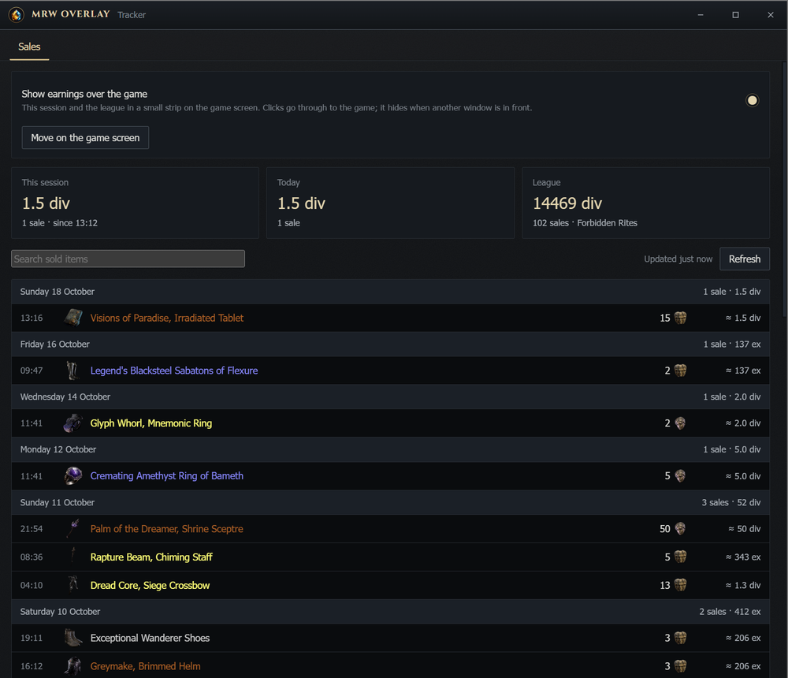 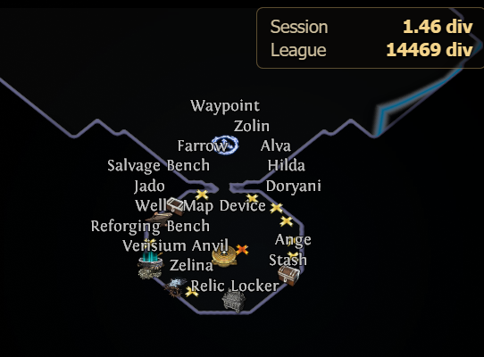</p>

### Paylaşılan filtre profilleri
League start, Expedition farmı ya da sıkı bir endgame filtresi için ayrı ayarlar tut, tek tıkla aralarında geçiş yap. Profilini yayınla, başkaları takip etsin; ya da diğer oyuncuların paylaştıklarına göz at, en çok takip edilenler en üstte. Takip ettiğin profil, sahibi değiştirdikçe kendiliğinden güncellenir.

<p align="center">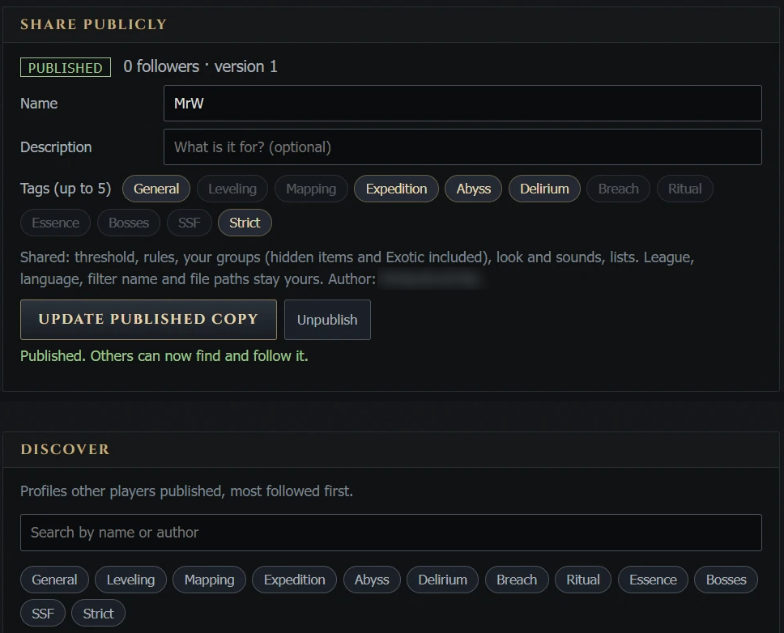</p>

### Temalar
Uygulamanın görünümü de sana kalmış: MrW Default, Dark ya da Light'tan birini seç veya birini kopyalayıp kendine göre düzenle. Uygulamanın teması, filtre renklerinden ayrıdır.

<p align="center">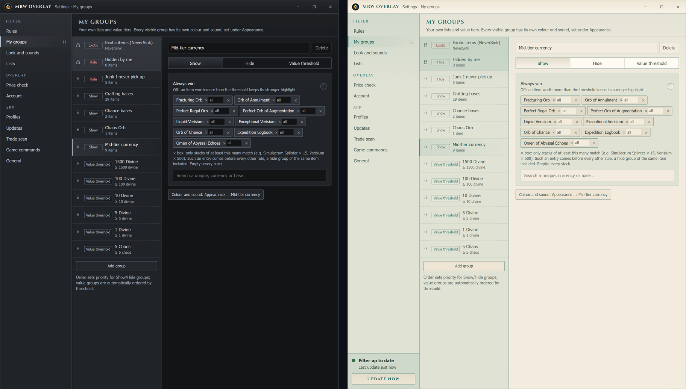</p>

### Ve küçük ama işe yarayan şeyler
- **Oyun kısayolları:** F5 /hideout, F6 /dnd, F7 sana son whisper atanı partiye çağırır, F8 hazır bir cevap yollar. Hepsi değiştirilebilir.
- **Uygulama üç dilde, oyun dokuz dilde:** uygulamanın kendisi English, Türkçe ve 繁體中文 konuşur. Fiyat sorgusu, trade ve Expedition etiketleri ise oyununun dilini izler: İngilizce, Almanca, Fransızca, İspanyolca, Portekizce, Rusça, Japonca, Korece ya da Geleneksel Çince. Loot filtresinin içindeki eşya adları İngilizce kalır, çünkü oyunun filtresi her dilde eşyaları İngilizce adlarıyla tanır.
- **Dosya olarak profil:** profilini dışa aktarıp arkadaşına ver, ya da yalnız hazır filtre dosyasını paylaş.

## İşi doğru yapmak için

Bir özellik, oyunda gerçekten çalışana ve kurallara uyana kadar yayınlanmaz.

- **Bellek okuma yok, otomatik tuş basma yok.** Uygulama oyunun belleğine dokunmaz, senin yerine tuşa basmaz, tıklamaz. Bir kısayol bir işlem demektir. Hareket ettirdiği tek şey, Alt+I envanteri okurken bir anlığına fare imlecidir.
- **Trade sitesine nazik.** Her istek, trade sitesinin bildirdiği hız sınırlarına uyar. Exceptional tabanlar MrW Overlay'in kendi sunucularında taranır; senin trade kotan sana kalır.
- **Ekran yalnız sen isteyince okunur.** Expedition ve gem okuma, her tuşa basışta ekranı bir kez yakalar ve Windows'un kendi OCR'ıyla, oyununun dilinde, senin bilgisayarında okur. Envanter taraması sen Manuel ya da Otomatik seçene kadar kapalıdır. Hiçbir şey yüklenmez.
- **Oturumun bilgisayarında kalır.** pathofexile.com hesabını bağlarsan oturum Windows DPAPI ile şifrelenir ve yalnız pathofexile.com'a gider.
- **Zayıf veriyle drop gizlenmez.** Tek ilanı olan bir unique ya da birkaç ilanlı bir exceptional asla gizlenmez.
- **Açıkta derlenir.** GitHub'daki her sürümün exe'si bu depodan [GitHub Actions](.github/workflows/release.yml) ile derlenir, hiçbir geliştiricinin bilgisayarında değil; indirdiğin şey burada okuyabildiğin koddur.
- **Güvenli güncelleme.** GitHub sürümü her güncellemeyi SHA-256 ile doğrular, yeni sürüm açılmazsa eskisine döner. Store sürümünü Store günceller.
- **Tepside hafif.** Boşta ölçüldü: tek CPU çekirdeğinin yaklaşık %0,2'si.
- **Gerçek oyuncular sürekli test ediyor.** Belirli bir aktif oyuncu grubu uygulamayı her gün kullanıyor ve her yeni özelliği kendi map'lerinde deniyor.
- **Otomatik testler.** Filtre kuralları, trade istemcisi, eşya okuyucu ve craft motoru 360 civarı otomatik testle sınanır; her sürüm bu testleri geçer.
- **Kendi kendine güncel kalır.** Fiyatlar ve NeverSink filtresi uygulama güncellemesi beklemeden yenilenir. Uygulama güncellemeleri oyunun yamalarını takip eder.

## Kurulum

- **Microsoft Store (önerilen):** [MrW Overlay for POE 2](https://apps.microsoft.com/detail/9PM376D3LFBG). Her Store uygulaması gibi kurulur ve güncellenir, SmartScreen uyarısı çıkmaz.
- **GitHub:** [Releases](../../releases/latest) sayfasından `poe2filtre-windows-amd64.exe`'yi indir. Kurulum yok, tek dosya. Exe kod imzalı olmadığı için SmartScreen "Windows bilgisayarınızı korudu" diyebilir: **Ek bilgi → Yine de çalıştır**. SHA-256 sürüm notlarında.

Sonra:

1. Uygulama sistem tepsisine yerleşir. Panel için simgeye tıkla, menü için sağ tıkla.
2. Oyunda: **Options → Item Filter → auto_updated**.
3. Her güncellemeden sonra filtrenin yanındaki **Reload**'a bas. Oyun filtreyi kendiliğinden yeniden okumaz.

Windows 10/11 ve WebView2 gerekir (Windows 11'de hazır gelir). Ayarlar `%APPDATA%\PoE2Filtre` altında durur, iki sürüm de aynı klasörü kullanır.

### Kaldırma

- **Microsoft Store:** Windows Ayarlar → Uygulamalar → Yüklü uygulamalar → MrW Overlay for POE 2 → Kaldır.
- **GitHub exe:** **Windows başlangıcında çalıştır**'ı açtıysan önce uygulamanın ayarlarından kapat. Sonra tepsi simgesine sağ tıkla → **Çıkış** ve exe'yi sil.

Ayarlarını da silmek için `%APPDATA%\PoE2Filtre` klasörünü sil. Üretilen filtre `Belgeler\My Games\Path of Exile 2` altındaki `auto_updated.filter`; oyunda artık istemiyorsan onu da sil.

### Tarayıcı eklentisi (isteğe bağlı)
Canlı arama, hideout'a gitme, satış takibi ve daha büyük aramalar için uygulamanın pathofexile.com oturumuna ihtiyacı var. Bunu küçük bir eklenti aktarır: [Chrome](https://chromewebstore.google.com/detail/ibjjhhjnfdokcbfckecbpkpibpdclpmn) · [Edge](https://microsoftedge.microsoft.com/addons/detail/djfodaadmhknalfdphcadiojbfabedlc) · [Firefox](https://addons.mozilla.org/firefox/addon/mrw-overlay-for-poe-2-bridge/). Eklenti yalnız sen **Ayarlar → Hesap → Tarayıcıyla bağlan**'ya bastığında devreye girer. Oturum çerezini ve hesap adını okuyup kendi bilgisayarındaki uygulamaya (`127.0.0.1`) verir. Asla şifre istemez ve sayfayı değiştirmez. Kaynak kodu: [`browser-extension/`](browser-extension/).

## SSS

**Filtre oyunda değişmiyor.** Uygulamada güncelle, sonra oyunda Options → Item Filter → **Reload**. Oyunu yeniden başlatmaya gerek yok.

**Ban yer miyim?** Uygulama oyun belleğini okumaz, oyuna tuş göndermez ve tıklamaz. Bir metin dosyası yazar, kısayola bastığında eşyayı oyunun kendi kopyalama komutuyla kopyalar, açtığın yerlerde ekranı okur ve herkese açık trade API'sini sınırları içinde kullanır.

**Çok fazla / çok az şey gizleniyor.** Önce değer eşiğini, sonra NeverSink sıkılığını ayarla. Sıkılık temeli belirler, eşik ise senin kurallarını.

**Bir eşyayı hep görmek istiyorum.** "Her zaman göster"e ekle ya da kendi grubunu yap. Yalnız unique halini istiyorsan `Taban adı|unique` yaz.

**Ucuz bir unique neden hâlâ parlıyor?** Unique'ler tanımlanmamış (unidentified) düşer ve loot filtresi yalnız tabanlarını (Sapphire Ring, Heavy Belt…) görebilir, hangi unique olduğunu göremez. Bu yüzden uygulama o tabanda düşebilecek bütün unique'lere bakar ve en değerlisine göre karar verir. Diyelim Sapphire Ring'in üç unique'i ucuz, biri pahalı: bütün unique Sapphire Ring'ler parlar, çünkü yerdeki pahalı olan da olabilir. Hangisinin düştüğünü görmek için identify et. O taban için durmaya değmiyorsa **Alt+H** onun unique'lerini gizler: tamamen ya da yalnız ucuz kaldıkları sürece. Tek ilanla gelen bir fiyat, bir tabanı gizlemek için asla sebep sayılmaz.

**Farklı içerikler için farklı ayarlar istiyorum.** Ayarlar → Profiller: kaydet, geçiş yap, dışa aktar ya da herkese açık bir profili takip et.

**Oyunum İngilizce değil.** Ayarlaman gereken bir şey yok: uygulama dili kopyaladığın eşyadan ve oyunun ayarlarından anlar. Skills panelindeki gem'ler ve Expedition ödülleri için Windows'ta o dilin OCR'ı gerekir (Windows Ayarlar → Zaman ve dil → Dil ve bölge → dili ekle). Yoksa Windows ekran dilinle okur; Latin harflerinde bu yeter, Rusça, Japonca, Korece ve Çince'de yetmez.

**Bir fiyat kaynağı çökerse?** Son bilinen fiyatlar kullanılır ve filtre yine yazılır.

**Sıfırdan başlamak istiyorum.** Uygulamayı kapat ve `%APPDATA%\PoE2Filtre` klasörünü sil.

## Projeye destek

MrW Overlay ücretsizdir ve öyle kalacak. Her yamaya ve her lige yetiştirmek çok akşam alıyor. İşine yarıyorsa bir [kahve ısmarlayabilir](https://buymeacoffee.com/mrworth) (hesap gerekmez; kart, Apple Pay ya da Google Pay), [GitHub Sponsors](https://github.com/sponsors/kadircelebi) üzerinden aylık destek olabilir ya da bu sayfaya bir ⭐ bırakabilirsin. Destek uygulamada hiçbir şeyin kilidini açmaz; herkes her özelliği kullanır.

<p><a href="https://buymeacoffee.com/mrworth"></a> <a href="https://github.com/sponsors/kadircelebi"></a></p>

Hata mı buldun, aklına bir fikir mi geldi? [Issue aç](../../issues/new/choose) ya da [Discord](https://discord.gg/835k5r4k8k)'a uğra.

## Gizlilik

Uygulamada telemetri ya da analiz yok; oturum çerezini ve hesap adını asla MrW Overlay sunucularına göndermez.

Herkese açık veriyi okur: fiyatları MrW Overlay'in GitHub'daki ortak fiyat dosyasından, o dosya altı saatten eskiyse doğrudan [poe.ninja](https://poe.ninja/), [poe2scout](https://poe2scout.com/) ve GGG'nin herkese açık Currency Exchange özetlerinden (`web.poecdn.com`); ilanları resmi trade API'sinden (başka bir dilde oynuyorsan sitenin o dildeki sürümünden, ör. de.pathofexile.com), NeverSink'in filtresini GitHub'dan.

- **Tarayıcı eklentisi:** bağlarsan oturumu ve hesap adını yalnız aynı bilgisayardaki uygulamaya verir. İkisi de Windows DPAPI ile saklanır. Oturum yalnız senin istediğin trade işlemleri için `www.pathofexile.com`'a gider. **Ayarlar → Hesap → Bağlantıyı kes** ikisini de siler.
- **Satış takibi:** varsayılan olarak kapalıdır. Açınca uygulama bağlı oturumla kendi satıcı satışlarını `www.pathofexile.com`'dan okur ve yalnız senin bilgisayarında saklar. Takip penceresindeki **Saklanan satışları sil** onları siler.
- **Herkese açık profiller:** isteğe bağlıdır. Yalnız yayınlarken ya da takip ederken MrW Overlay profil sunucusuyla (`profiles.mrwproject.com`) konuşulur. Yayınlarsan profilin filtre ayarları, adı, açıklaması ve etiketleri herkese açık olur; hesap adın da yazar olarak görünür. Lig, dil, dosya yolları, ses dosyaları, oturumun ve fiyat ayarların asla gönderilmez. Takip ettiğinde rastgele bir kurulum anahtarının özeti saklanır. Kötüye kullanımı sınırlamak için IP'nin kendisi değil, tuzlanmış özeti tutulur. Yayından kaldırınca profil ve takipçileri silinir.
- **Envanter taraması:** varsayılan olarak kapalıdır. Açıksa uygulama oyun penceresinin envanter bölümünü yakalar (Manuel: her Alt+I'de; Otomatik: hideout ya da kasabada envanter açıkken saniyede bir kadar) ve bilgisayarında okur. Görüntüler saklanmaz; yalnız kesin okunamayan hücrelerin küçük görüntüleri okuma hatalarını bulmak için `%APPDATA%\PoE2Filtre\debug\invscan` altında tutulur (en yeni 60). Karşılaştırdığı eşya görselleri GGG'nin görsel sunucusundan (`web.poecdn.com`) bir kez indirilir. Map kazancı ve süreler bilgisayarında kalır.
- **Fiyat sorgulama:** varsayılan olarak kapalıdır. Kısayola bastığında uygulama eşyanın metnini oyunun kopyalama komutuyla alır ve resmi trade API'sine bir arama gönderir.

Gizlilik politikasının tamamı: [poe2.mrwproject.com](https://poe2.mrwproject.com/tr/).

## Kod imzalama politikası

GitHub sürümündeki exe bu depodan GitHub Actions ile derlenir ([release workflow](.github/workflows/release.yml)). Hiçbir sürüm dosyası elle derlenip yüklenmez ve her sürüm yayınlanmadan önce onaylanır.

- Commit yetkisi ve inceleme: [kadircelebi](https://github.com/kadircelebi)
- Onay: [kadircelebi](https://github.com/kadircelebi)

Başka katkıcılardan gelen pull request'ler birleştirilmeden önce incelenir. Gizlilik: yukarıdaki [Gizlilik](#gizlilik) bölümü ve [gizlilik politikasının tamamı](https://poe2.mrwproject.com/tr/).

## Geliştiriciler için

Kod burada, uygulamanın tam olarak ne yaptığını görebilesin diye duruyor. Kendin derlemek istersen depoyu indir (**Code → Download ZIP**) ve **`build.bat`**'a çift tıkla. [Go](https://go.dev/dl/) 1.25+ ve [Node.js](https://nodejs.org/) 20+ kurulu mu diye bakar, gerekirse Wails CLI'yi kurar ve `bin\poe2filter.exe`'yi üretir. Windows Akıllı Uygulama Denetimi, kendi derlediğin imzasız exe'yi engeller; açık kalsın istiyorsan hazır exe'yi kullan.

```
wails3 build      # bin/poe2filter.exe
go test ./...     # Go testleri
cd frontend && npm run check   # tipler, çeviriler, kodlama
```

Uygulamaya yeni bir dil eklemek için `frontend/src/lib/locales/en.ts` ve `internal/i18n/en.go` dosyalarını kopyalayıp çevir; denetimler eksik anahtarları bildirir. `internal/overlay/data/locale/` altındaki oyun dili tabloları `python build/locale/build_locale.py <dil>` ile yeniden üretilir; her dilden kopyalanan eşyalar `internal/overlay/testdata/locale/` altında test edilir.

## Lisans

MIT, bkz. [LICENSE](LICENSE). İstisnalar [NOTICE](NOTICE) dosyasında. `internal/gamesounds/files/` altındaki 26 uyarı sesi Grinding Gear Games'e aittir. poe2db.tw'den gelen craft verisi CC BY-NC-SA 3.0 lisanslıdır. NeverSink'in filtresi de MIT lisanslıdır; uygulama onu çalışırken indirir. Oyun dili tabloları [Exiled Exchange 2](https://github.com/Kvan7/Exiled-Exchange-2)'nin verisinden üretilir (MIT).

MrW Overlay bir oyuncunun oyuncular için yaptığı bir araçtır. Grinding Gear Games'in resmî bir ürünü değildir ve onlar tarafından desteklenmez. Path of Exile 2 ve içindeki her şey onlara aittir.
